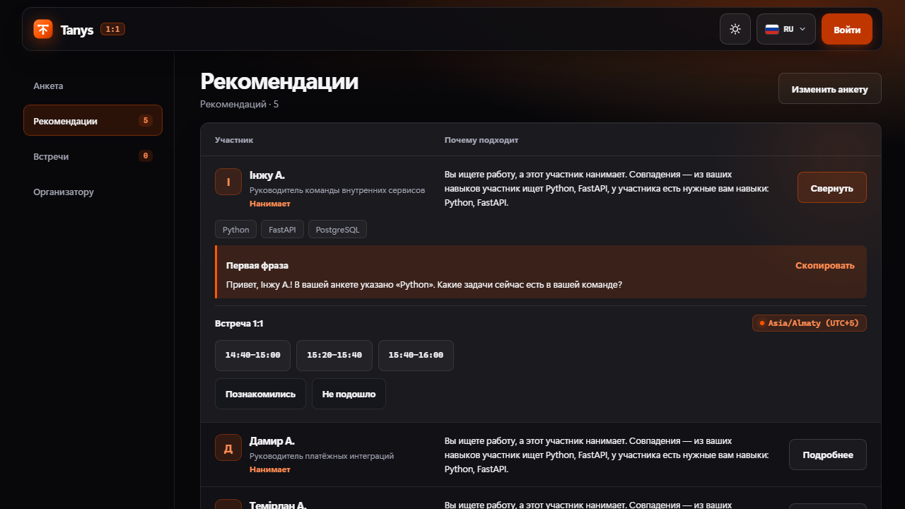

# Tanys

Tanys помогает участнику IT-мероприятия решить, с кем познакомиться и как начать разговор. По анкете сервис подбирает до пяти собеседников и объясняет каждую рекомендацию. Проект создан командой Meiirzhan, Dulat и Parasat для кейса Qazaq IT Community.

**[Открыть Tanys на Vercel](https://tanys-new.vercel.app/)** · [Презентация (PDF)](docs/tanys-presentation.pdf) · [База из 150 вымышленных анкет](src/data/profiles.json)

## Как попробовать

1. Откройте сайт и нажмите **«Заполнить пример»** или укажите свою роль, стек, опыт, интересы, пару слов о себе и цель знакомства.
2. Нажмите **«Найти участников»**. В карточке собеседника посмотрите причину рекомендации и скопируйте первую фразу для разговора.
3. Отметьте **«Познакомились»** или **«Не подошло»**. Список обновится с учётом ответа. Чтобы запланировать встречу, выберите свободный слот. Посмотреть или отменить запись можно в разделе **«Встречи»**.



Интерфейс, объяснения и первые фразы доступны на казахском, русском и английском. При смене языка введённые поля и список подобранных людей сохраняются.

## Как устроен подбор

Сначала Tanys проверяет взаимность целей. Соискателю подойдут участники, которые нанимают, а начинающему специалисту, который ищет ментора, — участники, готовые им стать. Для поиска кофаундера и обмена опытом сервис ищет людей с такой же целью.

Затем алгоритм учитывает искомые навыки, общий стек, интересы и опыт для менторства. Например, соискатель со знанием Python увидит выше в выдаче того, кто нанимает и указал Python среди нужных навыков. Причина в карточке строится из данных этой пары. Если совместимых анкет меньше пяти, сервис показывает все доступные.

В демо подбор работает прямо в браузере на синтетических анкетах. Введённая анкета и обратная связь хранятся в памяти до перезагрузки страницы. Слоты указаны по времени Алматы (UTC+5), а выбранные встречи сохраняются в локальном хранилище этого браузера. Аккаунты, обмен приглашениями между реальными участниками и общее расписание входят в [план публичного релиза 1.0](https://github.com/meiirzhan04/tanys/milestone/1).

## Локальный запуск

Для разработки нужны Git, Node.js 22.12 или новее из ветки 22 и npm.

```sh
git clone https://github.com/meiirzhan04/tanys.git
cd tanys
npm ci
npm run dev
```

Откройте адрес, который Vite выведет в терминал. Для запуска через Docker выполните из корня репозитория `docker compose up --build` и откройте [localhost:8080](http://localhost:8080). Команда `docker compose down` останавливает контейнер.

## Проверки и сборка

| Команда | Что проверяет или запускает |
| --- | --- |
| `npm test` | Тесты загрузки анкет, переводов, подбора, обратной связи, встреч и оценки релевантности |
| `node --experimental-strip-types tests/verify-matching.mjs` | Проверка подбора на полной базе по 13 контрольным анкетам |
| `npm run build` | Проверка типов TypeScript и сборка сайта в `dist/` |
| `npm run preview` | Локальный просмотр собранной версии после `npm run build` |

Для деплоя на Vercel используются настройки Vite. Корень проекта — корень репозитория, команда сборки — `npm run build`, каталог публикации — `dist`. Для текущей версии достаточно статического хостинга.

## Навигация по проекту

| Где | Что находится |
| --- | --- |
| [src/components](src/components) | Анкета, карточки рекомендаций и экран встреч |
| [src/matching](src/matching) | Типы анкет, правила ранжирования и пересчёт после обратной связи |
| [src/data](src/data) | Демонстрационные профили и проверка формата данных |
| [src/i18n](src/i18n) · [src/scheduling](src/scheduling) | Переводы и логика слотов |
| [tests](tests) | Контрольные сценарии и проверка качества выдачи |

Стек текущей версии — React, TypeScript и Vite. Для работы над задачей начните с [архитектуры](docs/architecture.md), [правил веток и проверок](AGENTS.md) и [задач команды](https://github.com/meiirzhan04/tanys/issues).

## Локальный сервер Tanys 1.0

Для разработки API запустите `docker compose -f compose.api.yaml up --build -d`. Compose поднимает PostgreSQL, применяет миграции и запускает сервер на `127.0.0.1:3000`. Проверки — `GET /health` и `GET /ready`. База изначально пуста. Команда `docker compose -f compose.api.yaml down` сохраняет данные в томе. Для другого локального порта задайте API_PORT. Для внешнего размещения передайте отдельные реквизиты БД через секреты окружения. [Контракт публичного API](docs/service-v1.md)

Для локальной проверки входа письма попадают в [тестовый почтовый ящик](http://localhost:8025). После запуска Compose выполните `node --test server/tests/auth.test.mjs`. В рабочем окружении задайте HTTPS-адрес приложения в APP_ORIGIN, защищённое SMTP-подключение в SMTP_URL и адрес отправителя в MAIL_FROM.

После первого подтверждённого входа оператор может выдать право создавать мероприятия командой `docker compose -f compose.api.yaml exec api node dist/grant-organizer.js user@example.org`. Подставьте адрес организатора. Право управления конкретным событием получает его создатель.

Для серверного входа на Vercel настройте [PostgreSQL, SMTP и миграции](docs/deployment-release.md#api-на-vercel).
