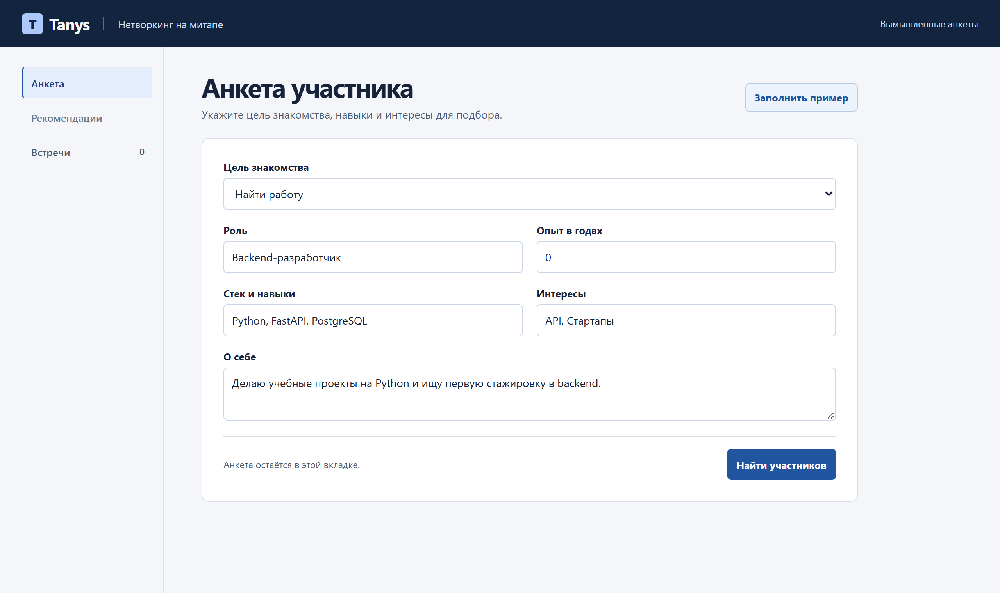
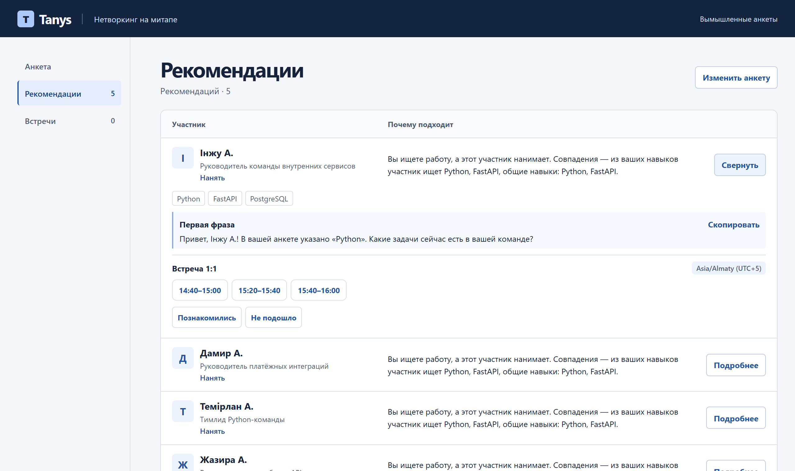

# Tanys — презентация (10 слайдов) и сценарий питча

Кейс: **Qazaq IT Community — AI-сервис умного нетворкинга** (AI in Engineering Hackathon 2026, METU).

Готовый PDF (10 слайдов): [`docs/tanys-presentation.pdf`](tanys-presentation.pdf)

## Слайды (10)

### 1. Титульный
- **Tanys** — умный нетворкинг для IT-митапов и конференций (300+ участников).
- Показывает до пяти собеседников с объяснением, первой фразой и записью на встречу 1:1.

### 2. Проблема
- На крупных митапах знакомства случайны: джуны не находят рекрутеров в зале, менти не видят наставников, фаундеры теряют время на несовпадающие цели.
- Участнику нужен ответ «к кому подойти прямо сейчас и с чего начать разговор» за 2 минуты.

### 3. Решение и анкета участника
- Веб-приложение **Tanys** с тремя разделами: **Анкета**, **Рекомендации**, **Встречи**.
- Работает полностью локально в браузере: без утечки API-ключей, без сетевых задержек, с сохранением ввода при редактировании.

### 4. Взаимность целей и пример пары с объяснением
- **Жёсткий фильтр взаимности:** `найти работу ↔ нанять`, `найти ментора ↔ стать ментором`, `кофаундер ↔ кофаундер`, `обмен опытом ↔ обмен опытом`.
- **Ранжирование:** искомые навыки (`lookingFor`, вес 8) → общий стек (вес 4) → общие интересы (вес 2) → направление опыта для менторства (вес 1) → стабильный tie-break по `id`.
- **Реальный пример пары из базы (`f48eba0`):**
  - *Участник:* Backend-разработчик, стаж `0`, стек `Python, FastAPI, PostgreSQL`, цель **Найти работу**.
  - *Рекомендация #1:* **Інжу А.** (`demo-041`), Руководитель команды внутренних сервисов, цель **Нанять** (`lookingFor: Python, FastAPI, PostgreSQL`).
  - *Объяснение:* «Вы ищете работу, а этот участник нанимает. Совпадения — из ваших навыков участник ищет Python, FastAPI, общие навыки: Python, FastAPI.»
  - *Первая фраза:* «Привет, Інжу А.! В вашей анкете указано «Python». Какие задачи сейчас есть в вашей команде?»

### 5. Итоговый интерфейс: рекомендации, фраза и слоты 1:1
- Список до 5 участников с раскрытием «Подробнее»: навыки, первая фраза с копированием, слоты 1:1 (`Asia/Almaty, UTC+5`) и обратная связь.

### 6. Синтетическая база анкет
- Все профили вымышленные, без парсинга LinkedIn/Telegram ([`src/data/profiles.json`](../src/data/profiles.json)).
- Валидация схемы и уникальности ID перед передачей в подбор ([`src/data/loadCandidates.ts`](../src/data/loadCandidates.ts)).
- **150 вымышленных анкет**, по **25** на каждую из шести целей (разработка, данные, дизайн, продукт, SRE).

### 7. Статус бонусов на `main`
- **Реализовано и слито в `main`:**
  - Первая фраза для знакомства с копированием и подтверждением (#6).
  - Обратная связь «Познакомились / Не подошло» с заменой карточки из пула (#11).
  - Слоты встреч 1:1 в часовой зоне `Asia/Almaty (UTC+5)` с защитой от конфликтов, `localStorage` и отменой (#13).
  - Запуск одной командой через Docker Compose (#15).
- **В работе / roadmap:** переключение языков kk/ru/en (#10), карта интересов организатора (#12), рекомендации стендов (#14).

### 8. Проверка качества и скорости (#5)
- Автотесты: `npm test` — **23/23 PASS** (все 6 целей, взаимность, icebreakers, фидбэк, слоты 1:1, валидация базы, строгие фикстуры).
- На 150 профилях проверили **10 независимых контрольных анкет** и **3 новых сценария команды**: **13/13 PASS**, минимум 3/5 релевантных в каждом запросе, всего **59/65** подходящих рекомендаций (**46/50 = 92%** на контрольной выборке).
- Скорость на ноутбуке для защиты: движок `0.08–0.60 мс`, в Chrome (360 px и 1280 px) от клика до карточки `12–42 мс` (при лимите `< 3 с`). [Отчёт #5](https://github.com/meiirzhan04/tanys/issues/5)

### 9. Архитектура и запуск
- Стек: React 19, TypeScript, Vite, Node test runner.
- Чистые модули без привязки логики к UI: `src/matching/`, `src/scheduling/`, `src/data/`, `src/components/`.
- Запуск за одну команду: `npm ci && npm run dev` или `docker compose up --build` (`http://localhost:8080`).

### 10. Живое демо и развитие
- Вводим новую анкету прямо на защите, получаем топ-5, раскрываем объяснение и первую фразу, отмечаем карточку, бронируем слот 1:1 и проверяем блокировку конфликта.
- Готовы принять 3 анкеты жюри прямо на ноутбуке. Следующие шаги для Qazaq IT Community: QR-чек-ин на митапе, мульти-ивент расписание и аналитика организатора.

---

## Сценарий питча (до 7 минут)

1. **0:00–0:45 — Проблема и цель (слайды 1–2):** 300+ человек в зале, случайные знакомства, цель Tanys — за секунду дать 5 взаимно полезных контактов.
2. **0:45–1:45 — Как работает подбор (слайды 4, 6):** взаимность целей, почему соискатель не видит других соискателей, приоритет `lookingFor` и объяснение на фактах пары.
3. **1:45–4:45 — Живое демо (слайды 3, 5, 10):**
   - Открыть Tanys (`http://localhost:8080` или `npm run dev`).
   - Заполнить **новую анкету** (например: *Junior Backend-разработчик*, стаж `0`, стек `Python, FastAPI, PostgreSQL`, интересы `API, Стажировки`, цель *Найти работу*, «О себе» — короткий текст) и нажать **«Найти участников»**.
   - Показать пять рекомендаций: объяснить вслух карточку **Інжу А.** — цель «Нанять» + совпадение `Python`/`FastAPI` из `lookingFor`.
   - Раскрыть **«Подробнее»**: скопировать **первую фразу**, нажать **«Не подошло»** (карточка замещается следующим кандидатом), забронировать слот **1:1** и показать блокировку этого слота у другого участника и вкладку **«Встречи»** с отменой.
   - Нажать **«Изменить анкету»** — показать сохранённые поля, сменить цель на *Найти ментора* и показать пересчёт.
4. **4:45–6:00 — Качество, тесты и запуск (слайды 7–9):** 23 автотеста, 59/65 на 13 сценариях, 3 контрольных прогона защиты, запуск через `docker compose up --build`.
5. **6:00–7:00 — Ответы на вопросы и проверка анкет жюри:** готовы ввести 3 анкеты от жюри прямо на ноутбуке.

## Ссылки сдачи (заполнить в #7 до 09:00 21 ноября)

- Публичный репозиторий: `https://github.com/meiirzhan04/tanys` *(открыть доступ в #42)*
- Датасет анкет: [`src/data/profiles.json`](../src/data/profiles.json)
- Презентация PDF (10 слайдов): [`docs/tanys-presentation.pdf`](tanys-presentation.pdf)
- Демо / видео (≤ 3 мин): `[добавить ссылку после #39]`
